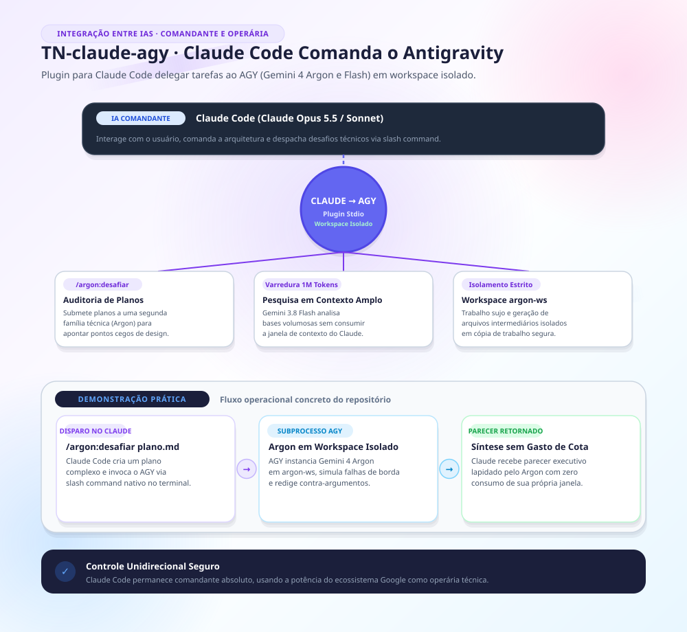

# TN-claude-agy — Ponte Claude (Comandante) → AGY (Operária)

> **Plugin para o Claude Code que coloca os modelos Gemini 4 Argon e Flash do Google Antigravity (AGY) a serviço do Claude Opus e Sonnet, com delegação segura em workspace isolado e auditoria independente por segunda família de IA.**


---

## 🏛️ 1. Arquitetura: IA Comandante & IA Operária

A ponte estabelece uma cooperação simbiótica entre dois ecossistemas líderes:
- **IA Comandante · Claude Code (Opus / Sonnet):** Preserva o contexto principal da sessão, define a estratégia arquitetural, coordena as tarefas e valida cada patch gerado antes de integrar.
- **IA Operária · Google Antigravity (Gemini 4 Argon / 3.8 Flash):** Executa tarefas de alta intensidade de leitura, pesquisas web e implementação em espaço temporário, consumindo a cota Google sem consumir os tokens da janela do Claude.

---

## ⚡ 2. Comandos Disponíveis no Claude Code

| Comando | Modelo / Cota | Finalidade Operacional |
|---|---|---|
| `/argon:status` | — | Verifica conectividade com o CLI `agy`, catálogo de modelos e integridade do workspace. |
| `/argon:perguntar <texto>` | `[Ultra]` Argon | Consulta técnica avulsa para obter uma segunda opinião fundamentada de IA. |
| `/argon:revisar [--adversarial] [ref]` | `[Ultra]` Argon | Revisão estruturada do diff de código recente; o Claude reconcilia os achados. |
| `/argon:desafiar <plano>` | `[Ultra]` Argon | Crítica cética e teste de estresse de um plano de implementação antes do início da escrita. |
| `/argon:explorar <pasta> \| <pergunta>` | `[Pro]` Flash | Varredura de diretórios extensos e documentação volumosa, retornando apenas síntese executiva. |
| `/argon:pesquisar <tema>` | `[Pro]` Flash | Pesquisa web ao vivo com extração de fontes citadas para verificação posterior do Claude. |
| `/argon:delegar <spec>` | `[Ultra]` Argon | Escrita completa de código com testes em workspace isolado, retornando como patch auditável. |

A skill `argon` orienta o Opus sobre quando acionar a ponte autonomamente, utilizando o subagente `argon:despachante`.

---

## 🛡️ 3. Isolamento e Segurança do Workspace

1. **Workspace Temporário Limpo (`scripts/area.py`):**
   - A execução ocorre em diretório efêmero (`C:\argon-ws\<id>` no Windows ou `/Users/Shared/argon-ws` no macOS).
   - Apenas arquivos versionados (respeitando `.gitignore`) são espelhados; o repositório principal permanece intocado.
2. **Perfil Efêmero e Restrito:**
   - Cada chamada executa sob perfil isolado temporário, sem expor credenciais, histórico ou plugins do usuário.
3. **Reconciliação Soberana:**
   - O AGY devolve exclusivamente patches (`.patch`) e relatórios JSON. O Claude Code inspeciona, valida os testes e decide se aplica ou refatora o código.

---

## 🚀 4. Instalação e Uso

### Pré-requisitos
- Python 3.10+
- Claude Code instalado e autenticado
- Google Antigravity (AGY) instalado e autenticado (`agy auth`)

### Instalação no Claude Code
```bash
# 1. Adicione o plugin localmente ao marketplace do Claude
claude plugin marketplace add ./

# 2. Instale o plugin
claude plugin install argon@argon-local
```

### Configuração Opcional (`~/.claude/argon.toml`)
Consulte o modelo em `argon.exemplo.toml` para definir diretórios de trabalho customizados e limites de timeout.

---

## 🧪 5. Testes Automatizados

```bash
python -m unittest discover -s tests -v
```
